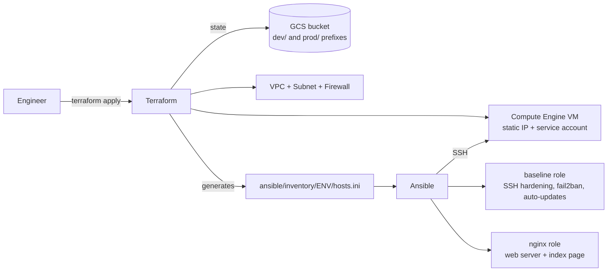

# Architecture

## Design decisions

| Decision | Reason |
|---|---|
| Terraform modules (`network`, `compute`) | Same code reused for dev and prod |
| Remote state in GCS with versioning | Safe, recoverable state; not stored in Git |
| One state prefix per environment | Dev and prod can never overwrite each other |
| Bootstrap folder with local state | Solves the chicken-and-egg problem of the state bucket |
| Terraform generates Ansible inventory | No manual copying of IP addresses |
| Plain `apt` + `service` tasks | Easy to read and explain |
| `validate:` on sshd_config | Ansible refuses to write a broken SSH config |
| Metadata SSH keys (OS Login disabled) | Simplest way for Ansible to connect while learning |

## Possible next steps

- Restrict SSH through IAP instead of a public SSH rule
- Workload Identity Federation + automated `terraform plan` in CI
- Molecule tests for Ansible roles
- Add a load balancer and multiple VMs
